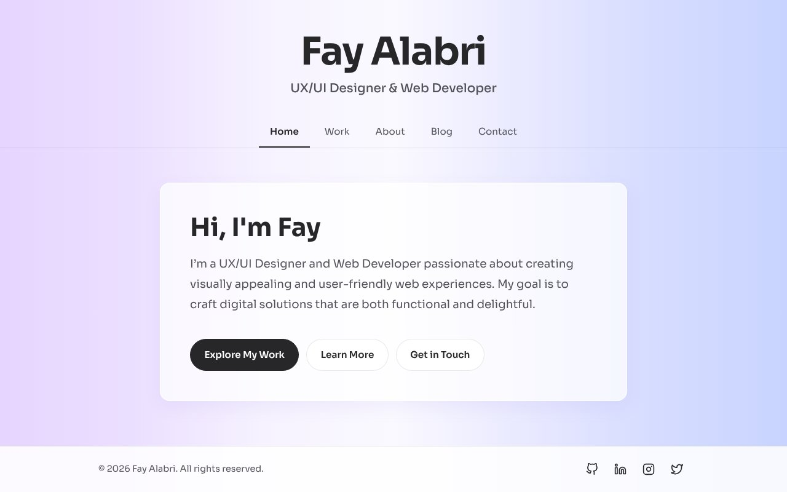
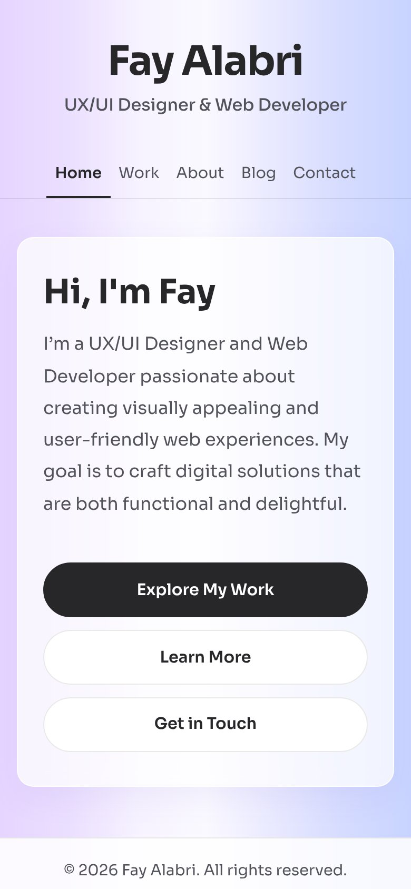

Fay Alabri - Web Developer Portfolio

Click here to visit my portfolio: https://irbala.github.io/FayAlabri/

  
  

Click a screenshot to open the live site.

Welcome to my personal portfolio! 
This website is a reflection of my journey as a passionate Web Developer and UX/UI Designer , showcasing my skills, projects, and experiences in the world of web development. Designed with creativity and functionality in mind, this portfolio highlights my ability to craft visually appealing, responsive, and user-friendly web solutions.

Through this portfolio, I aim to demonstrate my expertise in front-end development , UI/UX design , and problem-solving while providing insights into my work process and accomplishments. Whether you're an employer, collaborator, or fellow developer, this portfolio is designed to give you a clear understanding of my capabilities and passion for building impactful digital experiences.

-----------------------------

Website Structure

The website is organized into four main sections, each accessible via the navigation bar:

- Work, A showcase of my featured projects each in a card includes links to the live website and GitHub repository for further exploration.

- About, A detailed overview of my background, skills, and interests. Including my journey in software development and web development. Showcasing continuous growth in UI/UX design and problem-solving. And finally, my personal interests such as gaming and knitting that inspire creativity.

- Blog, Short write-ups about problems I've solved while building websites, starting with how I handle right-to-left Arabic layouts.

- Contact, A dedicated page for getting in touch. Including a direct email link with a one-click "Copy email" button, and a simple message form that opens your email app with everything filled in.
Also links to my social media profiles (LinkedIn, Instagram, Twitter) for networking and collaboration.

-----------------------------

Key Features

- Clean and Modern Design : Tailored to effectively showcase my work and provide a seamless user experience.
- Intuitive Navigation : Easy-to-use navigation bar allows visitors to explore projects, learn about me, and contact me effortlessly.
- Fully Responsive Layout : Optimized for all devices, ensuring a consistent experience on desktops, tablets, and mobile phones.
- Interactive Elements : Built with HTML and CSS, including hover effects, smooth transitions, and SVG icons.

-----------------------------

Topics
Web Development
Portfolio Design
Responsive Layout
Tech Stack: HTML, CSS
How to Use This Repository

-----------------------------

Explore the Pages 

Navigate through index.html (Home), work.html (Work), about.html (About), blog.html (Blog, with posts in the blog/ folder) and contact.html (Contact) to explore the full website. 404.html is the custom page GitHub Pages shows for missing pages.

## Design Decisions

- **Lavender palette.** A soft lavender-to-periwinkle gradient runs left to right, so it looks the same however long a page is. Content sits on frosted, semi-transparent cards (`backdrop-filter: blur`) so the colour shows through without hurting readability.
- **A deeper lavender for links and focus.** The pale gradient colours are too light for text, so links, focus outlines and tags use `#6d5bd0`, which keeps the lavender feel and passes contrast checks.
- **One typeface.** Sora, a rounded geometric sans, is used everywhere for a calm, modern look. <!-- guess: Fay, please confirm or edit -->
- **Plain HTML and CSS.** No framework or build step, so the site loads fast on GitHub Pages and every page is easy to read in the source.
- **Contact without a backend.** The contact form opens the visitor's own email app with the message filled in, so there is no server to run and no visitor data stored anywhere. A "Copy email" button sits next to the address for people who prefer webmail.
- **A blog for case studies.** Posts live in `blog/` as plain HTML pages using the same stylesheet, so writing a new one is copying an existing post and changing the text.

## Accessibility

Checked on 19 November 2026 with [axe-core](https://github.com/dequelabs/axe-core) 4.10, the engine behind Lighthouse's accessibility score, against WCAG 2.1 A and AA plus axe's best-practice rules. Every page was tested in a desktop browser.

| Page | Issues | Rules passed |
|---|---|---|
| `404.html` | ✅ 0 issues | 28 |
| `about.html` | ✅ 0 issues | 28 |
| `blog.html` | ✅ 0 issues | 28 |
| `contact.html` | ✅ 0 issues | 40 |
| `index.html` | ✅ 0 issues | 28 |
| `work.html` | ✅ 0 issues | 32 |

The new Blog page, first blog post and updated Contact page were checked too and pass with 0 issues.

-----------------------------

Contributions

This repository is intended as a personal portfolio. However, if you have suggestions or feedback, feel free to open an issue or submit a pull request!

-----------------------------

Contact Me

Thank you for visiting my portfolio! I hope you enjoy exploring my work and learning more about my journey as a web developer and designer.

If you'd like to collaborate, hire me, or just say hello, feel free to reach out:

Email: fayalabri@gmail.com
LinkedIn: linkedin.com/in/fayalabri
